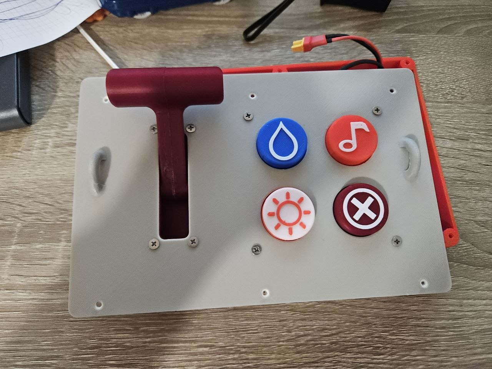
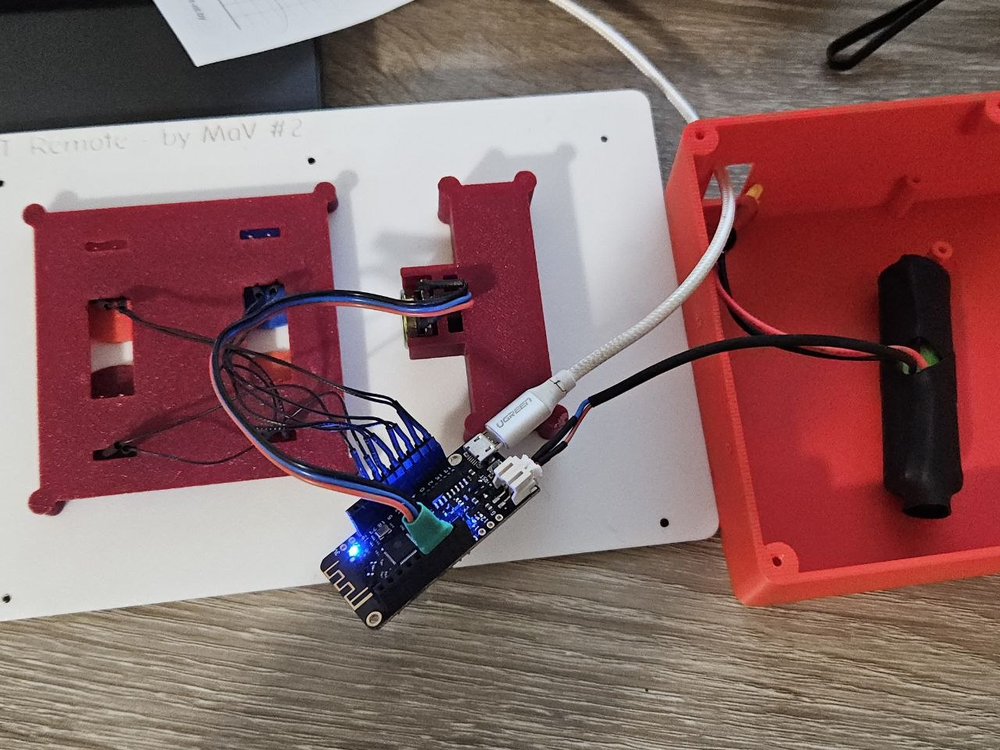
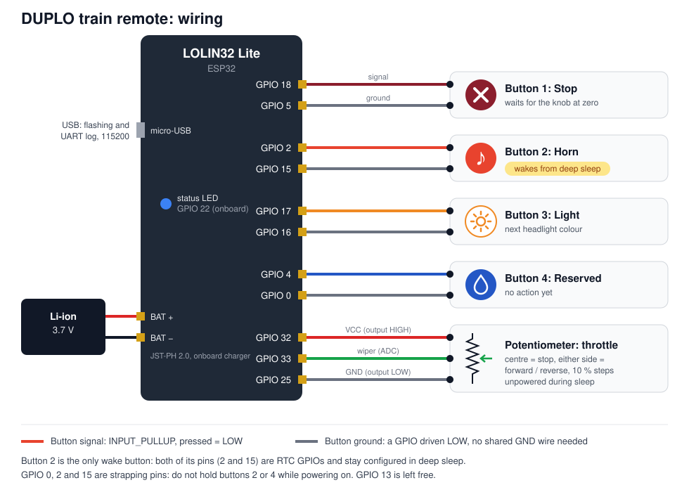

# LEGO DUPLO Train Remote

A handheld remote for the Bluetooth-enabled LEGO DUPLO train. It runs on an ESP32 (WEMOS LOLIN32 Lite) and talks to the train directly over Bluetooth Low Energy, with no phone or app. A throttle lever sets speed and direction; four buttons give stop, horn and headlight colour.

<p align="center">
  
  
</p>

> **Case and mechanics.** The 3D-printed enclosure, throttle lever and button caps are designed by **MaV**: Printables model **[Remote compatible with LEGO DUPLO train using ESP32](https://www.printables.com/model/878210-remote-compatible-with-lego-duplo-train-using-esp3)**. Print files, assembly notes and the mechanical design are there. This repository adds the firmware.

## Features

- **Finds the nearest train by itself.** The board scans for the LEGO hub service, picks the train with the strongest signal and connects in about 3 seconds. It reconnects automatically if the train is switched off and on again.
- **Never blocks.** All Bluetooth work runs in its own FreeRTOS task, so buttons and the throttle keep responding while it connects (measured loop gap under 2 ms).
- **Safe start.** After every connect, and after Stop, the train will not move until the throttle has been back at the centre. A reconnect with the lever pushed forward does not make the train jump.
- **Real deep sleep.** After 5 minutes without input, or when no train is found, the remote stops the train, disconnects and goes into ESP32 deep sleep. Button 2 wakes it.
- **Detailed UART log.** Every state change, connection step, error code and notification is logged at 115200 baud, which makes BLE problems easy to pin down.

## Controls

| Control | Action |
|---|---|
| Throttle lever | Centre = stop, either side = forward or reverse, 10–100 % in 10 % steps |
| Button 1 (✕) | Stop. The train stays stopped until the lever returns to the centre |
| Button 2 (♪) | Horn. Also the wake-up button while the remote sleeps |
| Button 3 (☀) | Next headlight colour |
| Button 4 (drop) | Reserved, no action yet |

Button actions, the throttle dead zone and the speed step live in [esp32_ble_test/src/config.h](esp32_ble_test/src/config.h).

### Status LED (onboard, GPIO 22)

| LED | Meaning |
|---|---|
| Fast blinking | Searching for the train or connecting |
| Steady on | Connected |
| Short flashes for 3 s | About to sleep; any button cancels |
| Off | Deep sleep. Press button 2 to wake |

## Hardware

- WEMOS LOLIN32 Lite (ESP32, onboard Li-ion charger, JST-PH 2.0 battery socket)
- 4 push buttons
- 1 linear potentiometer as the throttle
- Li-ion cell, 3.7 V
- 3D-printed case and mechanics, [see the Printables model](https://www.printables.com/model/878210-remote-compatible-with-lego-duplo-train-using-esp3)



| Part | Signal pin | Ground / supply pin |
|---|---|---|
| Button 1: Stop | GPIO 18 | GPIO 5 |
| Button 2: Horn, wake | GPIO 2 | GPIO 15 |
| Button 3: Light | GPIO 17 | GPIO 16 |
| Button 4: Reserved | GPIO 4 | GPIO 0 |
| Potentiometer | GPIO 33 (wiper, ADC) | GPIO 32 = VCC, GPIO 25 = GND |
| Status LED | GPIO 22 (onboard, active low) | — |

Each button has its own "ground" pin, a GPIO driven LOW, so all four buttons plug into one 8-pin run of the header: 15 2 0 4 16 17 5 18. GPIO 13 next to it stays free. The signal pins use the internal pull-up, so a press reads LOW. The potentiometer is powered from GPIOs too, so the firmware can switch it off during sleep.

Wiring notes:

- **Button 2 must stay on two RTC pins** (GPIO 0, 2, 4, 12–15, 25–27, 32–39). Only RTC pins keep working in deep sleep. Buttons 1 and 3 use non-RTC pins and cannot wake the board.
- **GPIO 0, 2 and 15 are strapping pins.** Don't hold button 2 or 4 while powering on, or the ESP32 may start its bootloader instead of the firmware.

## Power and sleep

The remote goes to sleep when:

- there are 5 minutes without a button press or lever movement;
- no train is found within 2 minutes;
- the train is lost and not found again within 1 minute.

Before sleeping it stops the train and disconnects. Then it holds the button 2 ground pin LOW, keeps a pull-up on its signal pin, powers down the potentiometer and enters deep sleep. Pressing button 2 restarts the firmware (about 1 s), and it starts searching for the train again.

### Checking sleep current with a voltmeter

You don't need a µA meter for this:

1. Put a 1 kΩ resistor in the battery's plus wire and bridge it with a jumper.
2. Power on and let the remote fall asleep (send `z` over UART, or wait 2 minutes with no train).
3. Remove the jumper and measure the voltage across the resistor. Every 1 mV is 1 µA.
4. Put the jumper back before pressing button 2, otherwise the board browns out when it wakes.

If the reading is near the battery voltage, or the board keeps rebooting, it is not asleep.

## Building and flashing

The firmware is a [PlatformIO](https://platformio.org/) project in `esp32_ble_test/`. It uses NimBLE-Arduino 2.5.1 as a git submodule, so clone with submodules:

```bash
git clone --recursive <repo-url>
cd lego_duplo_train_controller/esp32_ble_test
pio run -e lolin32_lite -t upload --upload-port COM9
pio device monitor -p COM9 -b 115200
```

Replace `COM9` with your board's serial port. If you already cloned without `--recursive`, run `git submodule update --init`.

### UART commands

| Key | Action |
|---|---|
| `s` | Status and counters |
| `0` | Stop, same as button 1 |
| `h` | Horn |
| `c` | Next headlight colour |
| `d` | Drop the connection (reconnect test) |
| `z` | Sleep now |
| `w` | Cancel falling asleep (during the 3 s warning) |
| `f` | Connect to a fake address (checks that a hanging connect does not block the controls) |

### Test without a train

Switch the train off and close the serial monitor, then run:

```bash
python tools/no_train_test.py --port COM9
```

The script needs `pyserial`. It resets the board and checks scanning, ten failing connects, that the loop never stalls, and the timeout into deep sleep. It takes about 2.5 minutes, and the board is asleep at the end.

### Button and sleep check

After changing the wiring, run the interactive check:

```bash
python tools/button_sleep_test.py --port COM9
```

It asks you to press each button and confirms that the board reports the right number. Then it puts the board to sleep and checks two more things: buttons 1, 3 and 4 leave the board asleep, and button 2 wakes it without sounding the horn.

## How it works

The firmware is a small state machine:

```
BOOT -> SEARCHING -> CONNECTING -> WAIT_RESPONSE -> CONNECTED
            |             |               |              |
            v             v               v              v
          SLEEP <---- RECONNECTING <------+--------------+
```

| State | What it does |
|---|---|
| `CONNECTING` | Four logged steps: link, LEGO service, characteristic, notifications |
| `WAIT_RESPONSE` | Waits for the hub's first notification, so a link that does not answer counts as a failure |
| `CONNECTED` | Sends the throttle value at most every 100 ms, and only when it changes |

Source files in `esp32_ble_test/src/`:

| File | Role |
|---|---|
| `main.cpp` | `setup()` and `loop()`, UART commands, heartbeat |
| `train_link.*` | Bluetooth state machine in its own task; the only place that calls NimBLE |
| `train_protocol.*` | LWP3 command bytes and notification decoding |
| `controls.*` | Buttons, knob, safety interlock, inactivity timer, status LED |
| `power.*` | Deep sleep and wake on button 2 |
| `config.h` | Pins and tuning values |
| `log.*` | UART log lines |

The train hub picks a new random BLE address on every power-on, so the remote recognises it by the advertised LEGO service `00001623-1212-efde-1623-785feabcd123`, not by address. After the first train is seen, the remote listens for one more second and connects to the one with the strongest signal, so with several trains switched on it picks the nearest. Hold the remote next to the train you want.

The CPU runs at 80 MHz instead of the default 240 MHz to save battery. That is the lowest clock Bluetooth works with, and the loop still never stalls longer than 2 ms.

### Protocol notes

The hub speaks LEGO Wireless Protocol 3 over characteristic `00001624-1212-efde-1623-785feabcd123`.

| Port | Function |
|---|---|
| `0x32` | Motor |
| `0x33` | Colour sensor (track tiles) |
| `0x34` | Sound and headlight |
| `0x35` | Battery voltage |
| `0x36` | Speed sensor |

| Command | Bytes |
|---|---|
| Speed `s` (−100..100) | `09 00 81 32 11 07 s 64 03` |
| Stop | `08 00 81 32 11 51 00 7F` |
| Horn | `0B 00 81 34 11 51 01 07 01 00 00` |
| Headlight colour `c` | `0B 00 81 34 11 51 01 04 01 c 00` |

The hub stops the motor by itself when the train is lifted and the wheels spin freely.

## Repository layout

| Path | Contents |
|---|---|
| `esp32_ble_test/` | ESP32 firmware (PlatformIO). Detailed notes in Russian in its [README](esp32_ble_test/README.md) |
| `duplo_train.py` | Python prototype: drives the train from a PC keyboard (Windows, `pip install bleak`) |
| `ESP32-C3_Test_Firmware/` | Earlier Arduino sketch for buttons and the throttle, before Bluetooth |
| `lib/NimBLE-Arduino/` | NimBLE-Arduino 2.5.1 (submodule) |
| `pics/` | Photos and the wiring diagram |

LEGO and DUPLO are trademarks of the LEGO Group. This is an unofficial hobby project.
